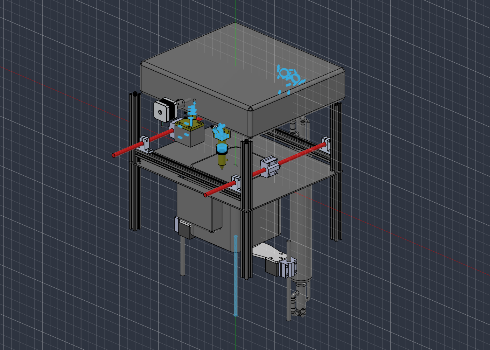
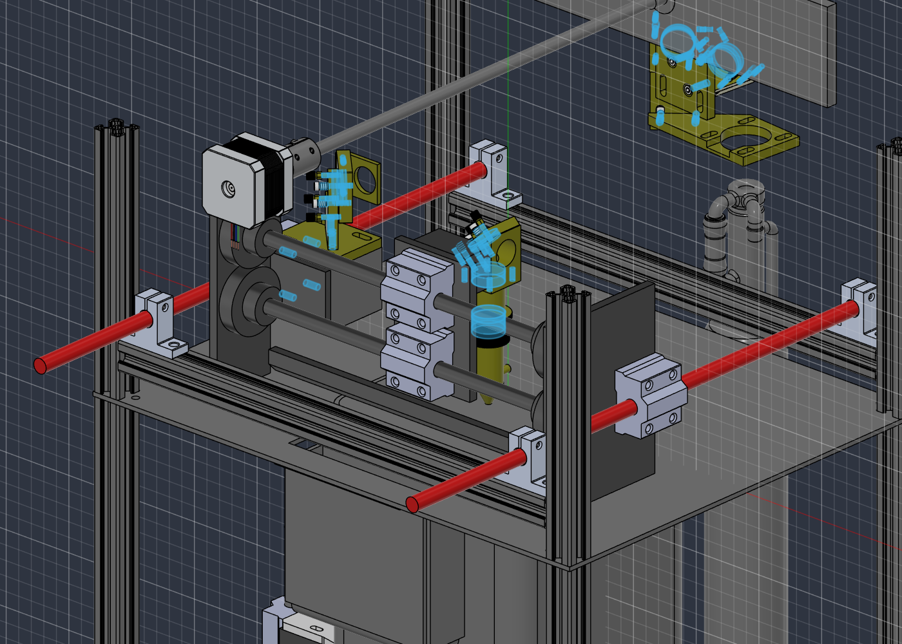
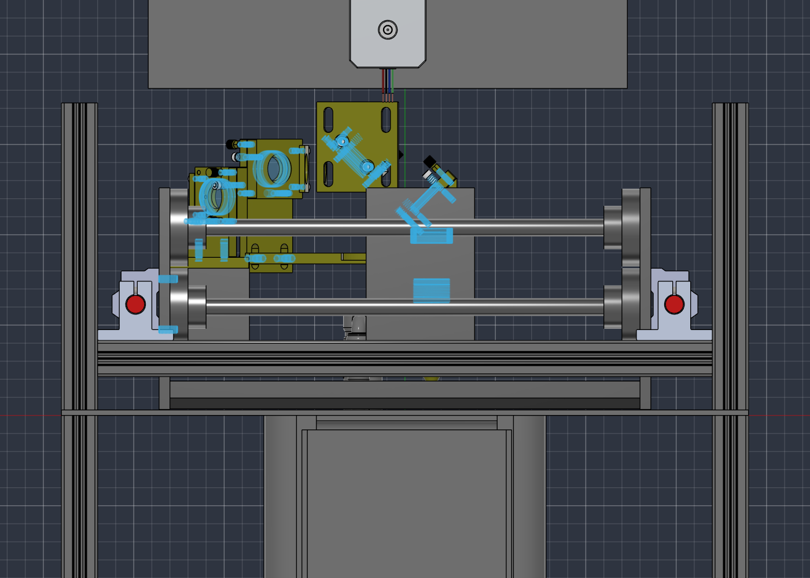

<div align="center">

# СПЕКС

### Компактный SLS-принтер с альтернативной системой подачи порошка




</div>

---

## О проекте

**СПЕКС** — это доступный принтер селективного лазерного спекания (SLS) для мелкосерийного производства и изготовления оснастки. Главная идея проекта в **удешевлённой подаче порошка**: вместо дорогого второго поршня или барабана порошок засыпается в бункер сверху и разравнивается гребёнкой на каретке.

## Ключевые характеристики

| Параметр | Значение |
|---|---|
| Область печати | 150 × 150 × 150 мм |
| Кинематика XY | H-bot на валах Ø10 мм, подшипники LM10UU с уплотнителями |
| Ось Z | подъёмный столик, без ходовых винтов в зоне печати |
| Лазер | CO₂-трубка сбоку, луч идёт через систему зеркал |
| Подача порошка | бункер сверху + гребёнка на каретке, съёмная коробка объёмом ×1,5 от зоны печати |
| Камера | герметичная, с подогревом, моторы вынесены за изоляцию |
| Корпус | обшивка из стеклотекстолита, теплоизоляция |
| Моторы | NEMA 17 (X, Y, гребёнка, подача), NEMA 23 (Z, высота гребёнки) |
| Электроника | BTT Octopus Pro + Klipper |
| Бюджет | до 15 000 ₽ |

## Как это работает

```
   ┌──────────── бункер с порошком ────────────┐
   │                    ▼                      │
   │   гребёнка на каретке разравнивает слой   │
   │                    ▼                      │
   │   CO₂-лазер → зеркала → спекание слоя     │
   │                    ▼                      │
   │   стол опускается на толщину слоя (Z)     │
   └──────────────── повтор ───────────────────┘
```

<div align="center">

<br><sub>Портал XY (H-bot), каретка с зеркалом и узел фокусировки</sub>
</div>

## Структура репозитория

| Папка | Что внутри |
|---|---|
| [`A3D/`](A3D) | основные сборки КОМПАС-3D («Внутренняя коробка», «Коробка 2.0») |
| [`M3D/`](M3D) | детали: бункеры, рама стола, каретки, направляющие, лазерная трубка |
| [`STEP/`](STEP) | STEP-модели покупных и собственных деталей (профиль 20×20, подшипники, моторы, зеркала) |
| [`SLS stp for IA/`](SLS%20stp%20for%20IA) | рабочая сборка; в [`АртSLS/`](SLS%20stp%20for%20IA/АртSLS) актуальная версия с гребёнкой, ремнями и оптикой |
| [`Мои профили/`](Мои%20профили) | библиотека профилей КОМПАС |
| [`docs/images/`](docs/images) | рендеры для README |

> Файлы `.a3d` и `.m3d` открываются в **КОМПАС-3D**, `.stp` / `.STEP` — в любом CAD (Fusion 360, FreeCAD, SolidWorks).

## Дорожная карта

- [x] Выбор кинематики (H-bot) и схемы подачи порошка
- [x] 3D-модель рамы, портала XY и оси Z
- [x] Компоновка лазера и зеркал
- [ ] Выбор модели CO₂-трубки
- [ ] Корпус и термоизоляция камеры
- [ ] Электроника и конфиг Klipper
- [ ] Собственный слайсер
- [ ] Сборка прототипа и тестовая печать

<div align="center">

</div>

---

<div align="center">
<sub>Автор: Piv · Научный руководитель: Алёна Павловна</sub>
</div>
