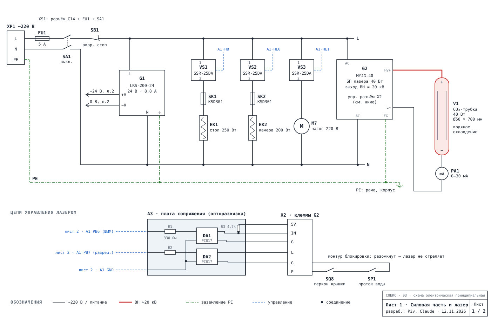
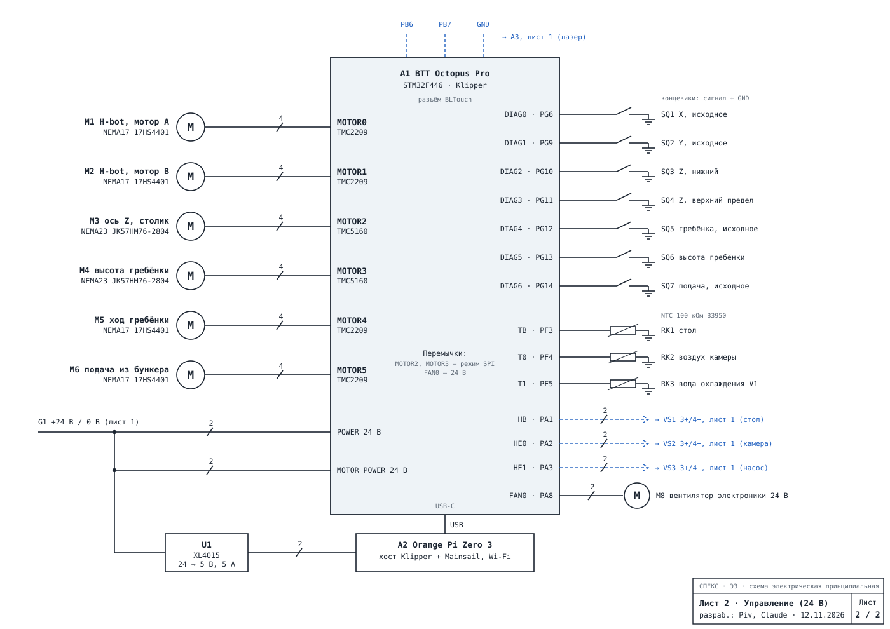

# Электрика СПЕКС

Схема электрическая принципиальная (Э3, 2 листа) и спецификация.

- `spetsifikatsiya.csv` — спецификация (открывается в Excel, разделитель «;»).
- `shema_i_spetsifikatsiya.html` — схема, спецификация, распиновка платы и примечания одной страницей.

Модель лазера, блоки питания, нагреватели и датчики выбраны как допущения, пока не утверждены.
